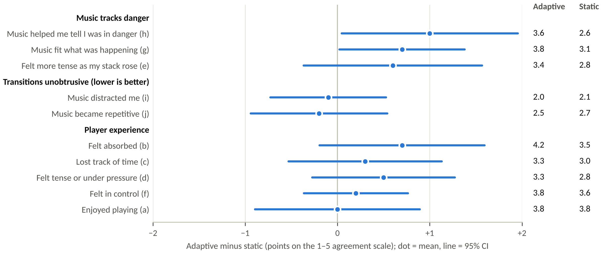
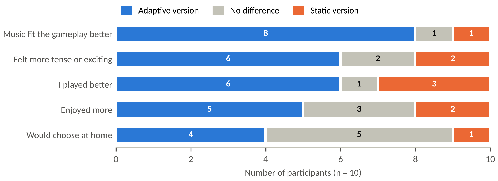

# Evaluation: adaptive vs static music

Everything from the player study reported in Section 3 of the final report: the instrument, the protocol, the coded data, the analysis code and the full results.

**Research question:** *How can continuously varying gameplay parameters be mapped to gradual musical change without producing unnatural or distracting transitions?*

For the main deliverable, that means testing **utility** (does the music track and communicate danger?) and **usability / UX** (are its changes unobtrusive, and how do they affect experience and performance?).

## Contents

| Path | What it holds |
|---|---|
| [`Protocol.md`](Protocol.md) | How each session was run: conditions, blinding, order, timing |
| [`Questionnaire/`](Questionnaire/) | The four-part paper questionnaire ([PDF](Questionnaire/Tetris_Music_Study_Questionnaire.pdf), [Word](Questionnaire/Tetris_Music_Study_Questionnaire.docx)) |
| [`Data/`](Data/) | Coded data: the original spreadsheet, CSV exports and the codebook |
| [`Analysis/`](Analysis/) | Python scripts that reproduce every number and chart, plus their output |
| [`Results.md`](Results.md) | Full results tables, order check and all written comments with themes |
| [`figures/`](figures/) | Charts used in the report |

## Study design

| | |
|---|---|
| **Design** | Within-subjects: every participant played both versions; order counterbalanced (odd IDs adaptive first) |
| **Conditions** | **Adaptive:** Danger follows the stack. **Static:** the same stems held at Danger 0.5 |
| **Blinding** | Builds called only *Version A* and *Version B*; on-screen Danger readout hidden |
| **Participants** | 10 adults recruited from friends and family; aged 18–44 (six aged 18–24); mostly casual players (six rarely or never play games; two had never played Tetris); all play with music on at least sometimes; none reported hearing difficulties |
| **Setting** | Participants’ homes, week 13; five minutes per version; same headphones and volume |
| **Measures** | Ten five-point statements (enjoyment, immersion, tension, control, and the music’s fit, danger signalling, distraction and repetition), a 1–10 music rating, whether the music changed, self-reported best score and game overs, forced-choice comparisons, written comments |
| **Analysis** | Exact Wilcoxon signed-rank tests with matched-pairs rank-biserial *r*; sign tests for forced choices; 2 × 2 crossover order check. A pilot: *p*-values uncorrected, effect sizes emphasised |

## Key findings



- **The music tracked and signalled danger (utility).** “The music helped me tell when I was in danger” rose from 2.6 to 3.6 (seven players higher, one lower; *r* = .81, *p* = .055), and “the music fit what was happening” from 3.1 to 3.8. Combined, these favoured the adaptive version for 8 of 10 players (*r* = .85, *p* = .014).
- **Players picked it as the better fit.** 8 of 10 chose the adaptive version’s music as fitting the gameplay better (sign test *p* = .039).



- **Transitions were gradual enough to go unnoticed.** The adaptive music was no more distracting (2.0 vs 2.1) or repetitive (2.5 vs 2.7). Only 3 of 10 noticed a difference between the versions, yet 4 of the 5 who reported none still chose the adaptive version as the better fit.
- **No performance cost.** Scores were similar (+6%, *p* = .56), and players reached Game Over less often with adaptive music (0.5 vs 1.6 per session), which held after allowing for practice (*p* = .032).
- **Enjoyment unchanged.** 3.8 vs 3.8. Absorption (+0.7) and the music rating (6.6 vs 5.9) leaned towards the adaptive version without reaching significance.
- **The adaptation can be too subtle.** Players who met the adaptive version second rarely topped out, and none of them noticed it changing. Because Danger reflects stack height alone, a player who keeps a low stack hears little adaptation.

## Limitations

Ten friends and family members playing at home is a small, possibly sympathetic sample in an uncontrolled setting. Performance was self-reported, sessions were short, and the static control shows that adaptation helps, not that continuous adaptation beats event-driven switching (the planned event-driven comparison is future work).

## Reproducing the analysis

Requires Python 3.10 or later.

```bash
cd Evaluation/Analysis
pip install -r requirements.txt
python analysis.py    # reads ../Data/Tetris_Music_Study_Data.xlsx, writes results.json, prints a summary
python figures.py     # writes the charts to ../figures/
```

[`Analysis/output.txt`](Analysis/output.txt) holds the printed summary from the run used in the report.
