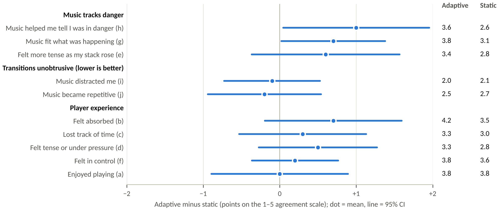
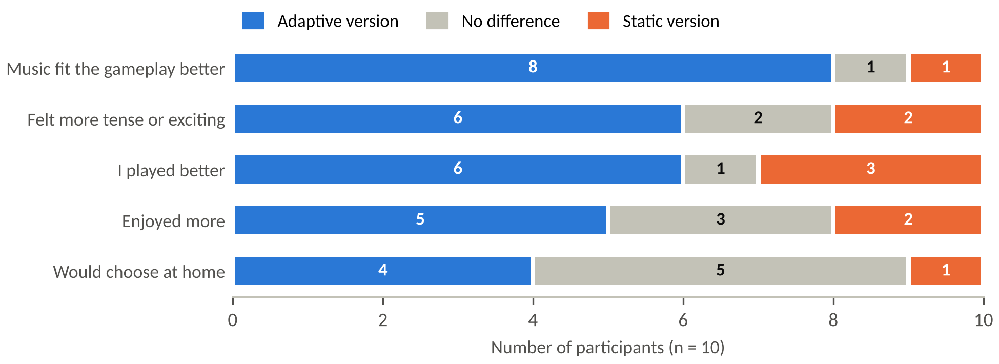

# Results

Full results of the adaptive-versus-static music study (n = 10). Every number here is produced by [`Analysis/analysis.py`](Analysis/analysis.py) from the coded data in [`Data/`](Data/); the same values appear in Section 3 and Appendices E–F of the final report.

**Contents:** [Paired comparisons](#paired-comparisons) · [Forced choices](#forced-choices) · [Order check](#order-check) · [Noticing the adaptation](#noticing-the-adaptation) · [Written comments](#written-comments)

## Paired comparisons

| Measure | Adaptive M (SD) | Static M (SD) | Difference [95% CI] | Higher / same / lower | Exact *p* | *r*rb |
|---|---:|---:|---:|:---:|---:|---:|
| Highest score | 4,963 (1,562) | 4,696 (1,614) | +267 [−588, 1,122] | 7 / 0 / 3 | .557 | +.24 |
| Game Overs (0–3) | 0.50 (0.97) | 1.60 (1.26) | −1.10 [−2.02, −0.18] | 0 / 5 / 5 | .062 | −1.00 |
| a. Enjoyed | 3.80 (0.92) | 3.80 (1.14) | +0.00 [−0.89, 0.89] | 3 / 5 / 2 | 1.00 | −.07 |
| b. Absorbed | 4.20 (0.79) | 3.50 (1.18) | +0.70 [−0.20, 1.60] | 6 / 2 / 2 | .180 | +.61 |
| c. Lost track of time | 3.30 (0.67) | 3.00 (1.25) | +0.30 [−0.53, 1.13] | 5 / 3 / 2 | .594 | +.32 |
| d. Tense / under pressure | 3.30 (0.48) | 2.80 (1.14) | +0.50 [−0.27, 1.27] | 5 / 3 / 2 | .250 | +.57 |
| e. More tense as stack rose | 3.40 (1.17) | 2.80 (1.03) | +0.60 [−0.37, 1.57] | 6 / 1 / 3 | .285 | +.47 |
| f. In control | 3.80 (1.03) | 3.60 (0.84) | +0.20 [−0.36, 0.76] | 4 / 4 / 2 | .688 | +.33 |
| g. Music fit the game | 3.80 (0.92) | 3.10 (0.74) | +0.70 [0.02, 1.38] | 6 / 3 / 1 | .094 | +.79 |
| h. Music signalled danger | 3.60 (1.07) | 2.60 (0.84) | +1.00 [0.05, 1.95] | 7 / 2 / 1 | .055 | +.81 |
| i. Music distracting (lower is better) | 2.00 (0.67) | 2.10 (0.99) | −0.10 [−0.73, 0.53] | 2 / 6 / 2 | 1.00 | −.20 |
| j. Music repetitive (lower is better) | 2.50 (1.35) | 2.70 (1.06) | −0.20 [−0.94, 0.54] | 3 / 3 / 4 | .766 | −.25 |
| Music rating (1–10) | 6.60 (1.07) | 5.90 (1.37) | +0.70 [−0.13, 1.53] | 6 / 2 / 2 | .125 | +.67 |

**Composites** (mean of two statements):

| Composite | Adaptive M | Static M | Difference | Higher / same / lower | Exact *p* | *r*rb |
|---|---:|---:|---:|:---:|---:|---:|
| Immersion (b, c) | 3.75 | 3.25 | +0.50 | 8 / 1 / 1 | .074 | +.64 |
| Tension (d, e) | 3.35 | 2.80 | +0.55 | 6 / 3 / 1 | .141 | +.68 |
| Music responsiveness (g, h) | 3.70 | 2.85 | +0.85 | 8 / 0 / 2 | .014 | +.85 |
| Music intrusiveness (i, j) | 2.25 | 2.40 | −0.15 | 2 / 3 / 5 | .594 | −.32 |

*Method.* Exact two-sided Wilcoxon signed-rank tests: zero differences excluded, tied ranks averaged, *p* from full enumeration of sign assignments. *r*rb is the matched-pairs rank-biserial correlation (Kerby, 2014); positive values mean higher ratings for the adaptive version. CIs are t-based on the mean paired difference. *Higher / same / lower* counts players whose adaptive value was above, equal to or below their static value. This is a pilot (n = 10), so *p*-values are not corrected for multiple comparisons. A paired t-test on score agrees with the Wilcoxon result (t(9) = 0.71, *p* = .498).

## Forced choices

Part 4 answers were ticked as Version A, Version B or no difference, then mapped to the condition each person played in that position.

| Question | Adaptive | No difference | Static | Sign test *p* |
|---|:---:|:---:|:---:|---:|
| 4.1 Which version did you enjoy more? | 5 | 3 | 2 | .453 |
| 4.2 Which version felt more tense or exciting? | 6 | 2 | 2 | .289 |
| 4.3 In which version did the music fit the gameplay better? | 8 | 1 | 1 | .039 |
| 4.4 In which version do you think you played better? | 6 | 1 | 3 | .508 |
| 4.5 If you were playing at home, which version would you choose? | 4 | 5 | 1 | .375 |

Sign tests exclude ‘no difference’ answers. **Order check on 4.1:** 3 chose the version they played first, 4 the version they played second and 3 no difference, so enjoyment preferences were not simply driven by play order.

## Order check

A 2 × 2 crossover analysis separates the effect of the music from practice (playing a second game). Each player's first-minus-second-game difference is compared between the adaptive-first group (P01, P03, P05, P07, P09) and the static-first group (P02, P04, P06, P08, P10) with exact Mann–Whitney tests (n = 5 per group).

| Measure | Adaptive − static (practice-adjusted) | *p* | First − second game (music-adjusted) | *p* |
|---|---:|---:|---:|---:|
| Game Overs | −1.10 | .032 | +0.70 | .151 |
| Highest score | +267 | .548 | −99 | .841 |
| h. Music signalled danger | +1.00 | .032 | −0.80 | .056 |
| g. Music fit the game | +0.70 | .095 | −0.10 | .841 |
| b. Absorbed | +0.70 | .222 | −0.10 | 1.00 |
| a. Enjoyed | +0.00 | 1.00 | +0.00 | 1.00 |
| f. In control | +0.20 | .548 | +0.00 | 1.00 |
| Music rating (1–10) | +0.70 | .222 | +0.30 | .690 |

Players reached Game Over less often with adaptive music even after allowing for practice (second games had 0.7 fewer game overs on average).

## Noticing the adaptation

‘Did the music change while you were playing?’ (question x.4):

| Version | Yes | No | Not sure |
|---|:---:|:---:|:---:|
| Adaptive version (all players) | 4 | 5 | 1 |
| Adaptive version, played first | 4 | 1 | 0 |
| Adaptive version, played second | 0 | 4 | 1 |
| Static version (all players) | 1 | 5 | 4 |

Difference noticed between versions (4.6): 1 clear, 2 slight, 5 none, 2 not sure. Of the 5 players who reported no difference, 4 still chose the adaptive version as the better fit (4.3). Players who met the adaptive version second rarely topped out (0.2 vs 0.8 game overs), so they probably spent little time in the upper layers, where the most audible changes happen.

## Written comments

All written answers, word for word, grouped by theme (coded inductively by the researcher).

| ID | Item | Context | Comment | Theme |
|---|---|---|---|---|
| P02 | 4.7 | Comparison (static first) | ‘Version B reacted to how I was doing. It got faster and heavier when my stack was high.’ | Linked music to stack; heard acceleration |
| P05 | 2.5 | Adaptive version (played first) | ‘Got faster near the top.’ | Linked music to stack; heard acceleration |
| P07 | 2.5 | Adaptive version (played first) | ‘Calmed down after I cleared lines.’ | Linked music to stack (calming) |
| P09 | 2.5 | Adaptive version (played first) | ‘Got louder when I was about to lose.’ | Linked music to stack |
| P07 | 4.7 | Comparison (adaptive first) | ‘I think Version A changed a little when things got hard.’ | Linked music to danger (tentative) |
| P06 | 4.7 | Comparison (static first) | ‘Maybe Version B was a bit more intense? Hard to say.’ | Unsure of a difference |
| P09 | 3.5 | Static version (played second) | ‘I think it changed but I'm not sure when.’ | Change reported in static music |
| P03 | 4.7 | Comparison (adaptive first) | ‘They sounded the same to me.’ | No difference heard |
| P09 | 4.7 | Comparison (adaptive first) | ‘They sounded the same to me.’ | No difference heard |
| P01 | 4.7 | Comparison (adaptive first) | ‘I was focused on the blocks, didn't really notice the music.’ | Attention on play, not music |
| P04 | 4.7 | Comparison (static first) | ‘I was focused on the blocks, didn't really notice the music.’ | Attention on play, not music |
| P05 | 4.7 | Comparison (adaptive first) | ‘Not sure, I wasn't really listening.’ | Attention on play, not music |
| P10 | 4.7 | Comparison (static first) | ‘I was focused on the blocks, didn't really notice the music.’ | Attention on play, not music |
| P04 | 4.8 | Comparison (static first) | ‘Would be nice to have a hold piece.’ | Feature request (hold piece) |
| P08 | 4.8 | Comparison (static first) | ‘A bit hard to start with.’ | Difficulty at start |
| P03 | 4.8 | Comparison (adaptive first) | ‘Fun game, controls felt good.’ | General feedback (positive) |
| P06 | 4.8 | Comparison (static first) | ‘The music was catchy.’ | General feedback (positive) |
| P10 | 4.8 | Comparison (static first) | ‘Enjoyed it!’ | General feedback (positive) |

Comments linking the music to the stack or to danger came from four players (P02, P05, P07, P09). P09’s comment on the static version (3.5) reports a change that did not happen.

## Reference

Kerby, D. S. (2014). The simple difference formula: An approach to teaching nonparametric correlation. *Comprehensive Psychology, 3*, Article 1. https://doi.org/10.2466/11.IT.3.1
