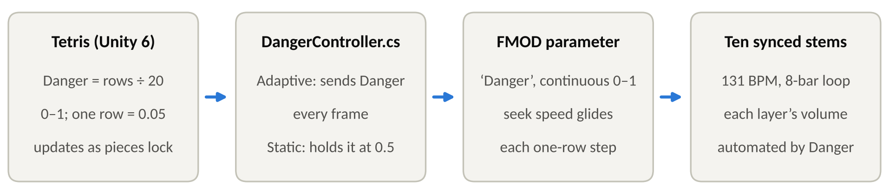
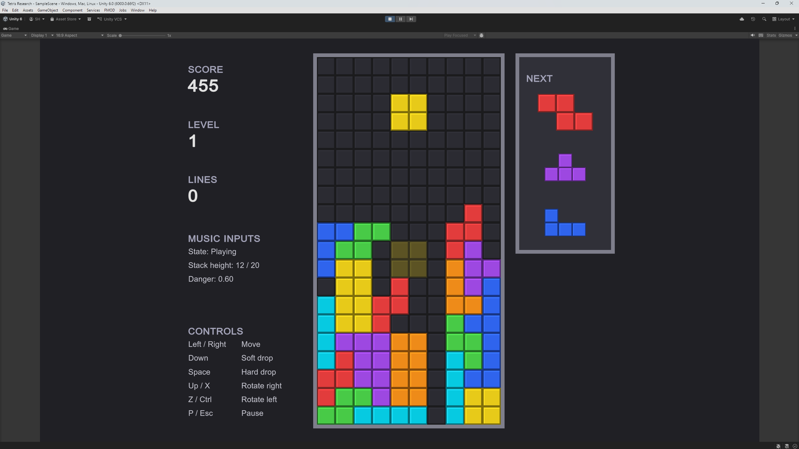
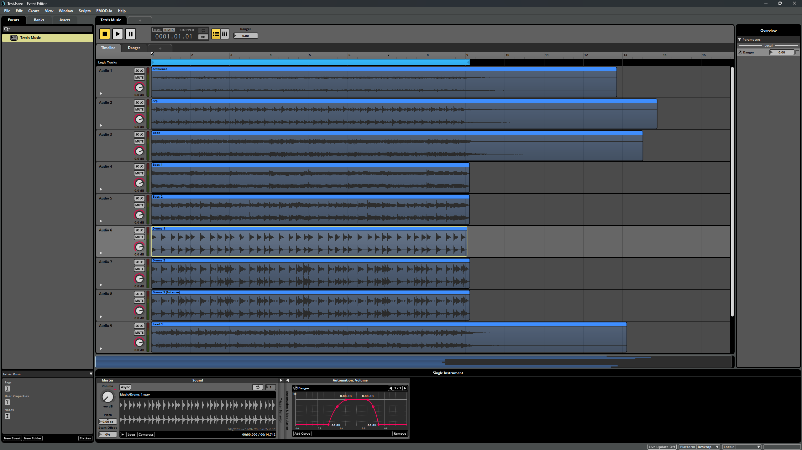
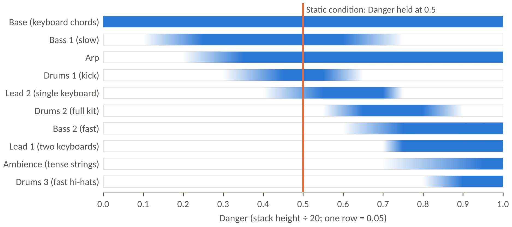

# Continuous Adaptive Music in Tetris

A Unity 6 Tetris prototype whose soundtrack adapts **continuously** to danger. The height of the stack becomes a 0–1 `Danger` value that drives an FMOD Studio parameter, which fades ten synchronised music stems in and out in real time. Built and evaluated for COMP3180 at Macquarie University (Session 2, 2026) to answer:

> *How can continuously varying gameplay parameters be mapped to gradual musical change without producing unnatural or distracting transitions?*

| | |
|---|---|
| **Portfolio video** | [Echo360 link] |
| **Evaluation artefacts** | [`Evaluation/`](Evaluation/): questionnaire, protocol, coded data, analysis code and results |
| **Built with** | Unity 6 (6000.0.66f2), FMOD Studio and FMOD for Unity |






## Contents

- [Key results](#key-results)
- [Repository layout](#repository-layout)
- [Getting started](#getting-started)
- [How it works](#how-it-works)
- [Running the study conditions](#running-the-study-conditions)
- [Reusing the system](#reusing-the-system)
- [Script reference](#script-reference)
- [Troubleshooting](#troubleshooting)
- [Credits and references](#credits-and-references)

## Key results

In a blind, counterbalanced study with ten players ([full results](Evaluation/Results.md)):

- **The music signalled danger.** Players agreed more that the adaptive music helped them tell when they were in danger (3.6 vs 2.6 on a 5-point scale) and fit what was happening (3.8 vs 3.1). 8 of 10 chose it as the better fit.
- **The transitions went largely unnoticed.** It was no more distracting or repetitive than static music, and only 3 of 10 consciously noticed a difference between the versions.
- **No performance cost.** Players reached Game Over less often with adaptive music (0.5 vs 1.6 per five-minute session). Enjoyment was unchanged (3.8 vs 3.8).

## Repository layout

| Path | What it is |
|---|---|
| [Unity project folder] | The Unity 6 project: game scene, the six C# scripts below, FMOD for Unity integration |
| [FMOD Studio project folder] | The music event: ten stems, the `Danger` parameter and its automation |
| [`docs/images/`](docs/images/) | Diagrams used in this README |
| [`Evaluation/`](Evaluation/) | Player study: [protocol](Evaluation/Protocol.md), [questionnaire](Evaluation/Questionnaire/), [data](Evaluation/Data/), [analysis](Evaluation/Analysis/), [results](Evaluation/Results.md) |

## Getting started

### Requirements

- **Unity 6000.0.66f2** (Unity 6). The project started from Unity’s default 2D template.
- **FMOD Studio** and the **FMOD for Unity** package, at matching versions.
- Headphones. The music is the point.

### Run it

1. Clone the repository and open the Unity project folder in Unity Hub.
2. If FMOD reports missing banks, open the FMOD Studio project and build it (**File → Build**, or **F7**). Unity loads the banks from the location set in **FMOD → Edit Settings**.
3. Open the game scene, press **Play**, click inside the Game view and press **Enter**.

Only the Base layer plays at first. To hear every layer quickly, keep hard-dropping pieces into the middle with **Space**: the stack climbs and the layers arrive one by one.

### Controls

| Key | Action |
|---|---|
| ← / → (or A / D) | Move; hold to auto-repeat |
| ↓ (or S) | Soft drop |
| Space | Hard drop |
| ↑, X or W | Rotate clockwise |
| Z or Ctrl | Rotate anticlockwise |
| P or Esc | Pause / resume |
| Enter (or Space) | Start, resume, play again |
| R | Restart (from pause or game over) |

## How it works

### 1. The game measures danger

`TetrisGame.Danger` is the height of the tallest column as a fraction of the 20 visible rows:

```csharp
public float Danger => Board == null ? 0f : Mathf.Clamp01((float)StackHeight / Board.VisibleHeight);
```

It changes only when a piece locks or lines clear, so it moves in steps of 0.05 (one row). The game deliberately does **no smoothing**: it reports a clean measurement, and the music side decides how to turn those steps into gradual change. The game also raises C# events (`GameStarted`, `StateChanged`, `StackHeightChanged` and others, listed [below](#events)), so audio and other systems can listen in without editing game code.

### 2. `DangerController` bridges the game and FMOD

`DangerController.cs` sits on the GameObject that holds the FMOD Studio Event Emitter for the music:

| When | What it does |
|---|---|
| New game (`GameStarted`) | Starts the music from bar 1 at full volume and sets `Danger` **instantly** (skipping seek speed), so a new game never glides down from the last one’s value |
| Every frame while playing | Sends `Danger` with `EventInstance.setParameterByName`, or the fixed **Static Danger** value when **Adaptive** is unticked |
| Pause / resume | Pauses and resumes the event; `Danger` is frozen while paused |
| Game over | Fades the music out over 1.5 s, then stops it |

| Inspector field | Default | Purpose |
|---|---|---|
| Emitter | (same GameObject) | The Studio Event Emitter playing the music event |
| Game | (found in scene) | The `TetrisGame` to read `Danger` from |
| Parameter Name | `Danger` | Must match the FMOD parameter name exactly |
| Adaptive | on | On: music follows the stack. Off: music held at Static Danger |
| Static Danger | 0.5 | The value used when Adaptive is off (the study’s static condition) |
| Fade Out Seconds | 1.5 | Fade length at game over |

Set the emitter’s **Play Event** to **None** and untick **Trigger Once**: the script starts the music, and it must be able to restart it every game.

### 3. The FMOD event

- A 2D timeline event (music shouldn’t come from a position in the world).
- **Tempo marker** on the logic track: 131 BPM, 4/4. **Loop region** from bar 1 to bar 9: 8 bars, 14.66 s.
- **Ten tracks**, one stem each, all starting exactly at bar 1. *Loop Playback* is off on the instruments: the timeline loop repeats every stem together, so they can never drift apart.
- The stems were exported with wrapped reverb tails, so nothing is cut off at the loop point.
- **`Danger`** is a continuous user parameter from 0 to 1. Its [seek speed](https://www.fmod.com/docs/2.00/studio/parameters-reference.html) makes each 0.05 step ramp over roughly one to two seconds instead of jumping. <!-- TODO: state the exact seek speed you settled on -->
- Each track’s volume is automated against `Danger` (below). The event is built to the Master bank.

### 4. Layer map



| Layer | Content | Fades in (silent → full) | Fades out (full → silent) |
|---|---|---|---|
| Base | Electronic keyboard chords, slow | always on | – |
| Bass 1 | Low bass guitar, slow notes | 0.10 → 0.25 | 0.60 → 0.75 |
| Arp | Arpeggio, gentle build-up | 0.20 → 0.35 | – |
| Drums 1 | Quick kicks | 0.30 → 0.45 | 0.55 → 0.65 |
| Lead 2 | Melody, single high keyboard | 0.40 → 0.55 | 0.70 → 0.75 (swap) |
| Drums 2 | Kick, hi-hat and snare rhythm | 0.55 → 0.65 | 0.80 → 0.90 |
| Bass 2 | Low bass guitar, fast notes | 0.60 → 0.75 | – |
| Lead 1 | Melody, two keyboards | 0.70 → 0.75 (swap) | – |
| Ambience | Electronic strings, slow and tense | 0.70 → 0.95 | – |
| Drums 3 | Drums 2 with a much faster hi-hat | 0.80 → 0.90 | – |

### 5. Design decisions

- **Vertical layering, not horizontal resequencing.** Fading synchronised stems in and out responds to a continuous value at any moment, with no need to wait for a musical transition point.
- **Variants swap, different parts stack.** Bass 1/2, Drums 1/2/3 and Lead 2/1 replace each other as danger rises; different instruments add on top. The most intense layers (Lead 1, Ambience, Drums 3) are kept for genuine trouble near the top of the board.
- **Design the resting states, not just the transitions.** `Danger` can sit on one value for minutes, so every value the game can produce must sound good on its own. Lead 1 and Lead 2 clash, so instead of crossfading over several rows (which could hold both at half volume for a long time) they hand over inside a single row step, and seek speed turns that step into a short glide.
- **Curved fades.** Fades are shaped so a layer’s loudness rises evenly instead of seeming to appear at the very end of its ramp.
- **Smoothing lives in FMOD, not in the game.** The game reports raw steps; seek speed shapes how fast the music follows. That keeps the measurement clean and lets the smoothing be tuned by ear without touching code.
- **Busier layers read as faster music.** The tempo never changes, but two players described the upper layers (fast bass, quicker hi-hats) as the music “getting faster”, suggesting layer density can do the job that tempo changes were originally planned for.

## Running the study conditions

Both study conditions use the same build ([full protocol](Evaluation/Protocol.md)):

1. **Adaptive:** tick **Adaptive** on `DangerController`.
2. **Static:** untick **Adaptive**. The music holds at **Static Danger** (0.5), a fixed mid-intensity mix of the same stems.
3. Untick **Show Music Inputs** on `TetrisView` so players cannot see the Danger readout.

## Reusing the system

- **Drive it from any game value.** `DangerController` only needs a 0–1 number each frame. To use another signal (health, time remaining, enemies nearby), replace `game.Danger` in `SendDanger()` with your value, or expose it as a property on your own game script.
- **Add or change layers without code.** Add a track in FMOD, automate its volume against `Danger`, and rebuild the banks (F7).
- **Rescale the input.** In the study, players who kept a low stack rarely heard the upper layers. Dividing by fewer rows (for example `StackHeight / 14f`) brings the later layers into normal play.
- **Compare against event-driven music.** Snapping `Danger` to a few thresholds before sending it (for example `Mathf.Floor(danger * 4f) / 4f`) and setting the seek speed to instant gives an event-driven version for comparison, which is the next planned study.

## Script reference

| Script | Responsibility |
|---|---|
| `Tetromino.cs` | The seven piece shapes, colours and rotation states, and the Super Rotation System (SRS) wall-kick tables |
| `TetrisBoard.cs` | The grid and its rules: does a piece fit, place it, clear full rows, measure stack height. No rendering, input or timing |
| `TetrisInput.cs` | Keyboard bindings in one place; compiles against either the Input System or the old Input Manager |
| `TetrisGame.cs` | The rules and game loop: gravity (Tetris guideline curve), lock delay with a reset limit, auto-repeat movement, 7-bag randomiser, scoring and levels. Exposes state as properties and events |
| `TetrisView.cs` | Draws everything from code-generated sprites (no imported art), frames the camera, and shows the score panel, next-piece preview and optional *Music inputs* readout |
| `DangerController.cs` | Plays the FMOD music event and feeds it `Danger`; handles pause, game over and the adaptive/static toggle |

### Events

Subscribe from any script, as `DangerController` does with `GameStarted` and `StateChanged`.

| Event | Fires when |
|---|---|
| `GameStarted` | A new game begins |
| `StateChanged(TetrisState)` | The state changes: Ready, Playing, Paused or GameOver |
| `PieceSpawned(TetrominoType)` | A new piece appears |
| `PieceMoved` | A piece moves one step left or right |
| `PieceRotated` | A rotation succeeds |
| `PieceHardDropped(int rows)` | A piece is hard-dropped |
| `PieceLocked` | A piece locks into the stack |
| `LinesCleared(int count)` | One to four rows are cleared (four is a Tetris) |
| `LevelChanged(int level)` | The level changes |
| `StackHeightChanged(int rows)` | The stack height changes (`Danger` is the 0–1 version) |

### Tuning (`TetrisGame` inspector)

Board width and height (10 × 20), start level, lines per level (10), whether speed rises with level, soft-drop interval (0.05 s), lock delay (0.5 s), maximum lock resets (15), auto-repeat delay and interval (0.17 s / 0.05 s) and preview count (3). For calm music tests, untick **Speed Up With Level** or lower **Start Level**.

## Troubleshooting

| Symptom | Fix |
|---|---|
| Red Console errors mentioning `UnityEngine.InputSystem` | Install **Input System** from the Package Manager, or set **Project Settings → Player → Active Input Handling** to **Input Manager (Old)** |
| Keys do nothing | Click inside the Game view to give it focus, then press Enter |
| Blocks look dark or black | URP’s default sprite material needs a 2D light; `TetrisView` switches to the unlit sprite shader when URP is active. If that shader isn’t found (for example in a build), add a **Global Light 2D** |
| Music starts before you press Enter | Set the emitter’s **Play Event** to **None**; `DangerController` starts the music |
| Music only plays in the first game | Untick **Trigger Once** on the emitter |
| Layers pop in abruptly | Lower the `Danger` parameter’s seek speed in FMOD Studio, then rebuild the banks |
| FMOD changes don’t show up in Unity | Rebuild the banks in FMOD Studio (**F7**) |
| FMOD debug overlay on screen | **FMOD → Edit Settings**: set **Debug Overlay** to **Disabled** under **Play In Editor** and **Default** (builds use Default) |

## Credits and references

- **Music:** ten stems composed and produced in FL Studio by [producer’s name], to a layering brief written for this project.
- **Rotation system:** SRS wall-kick data from the [TetrisWiki](https://tetris.wiki/Super_Rotation_System). Tetris was created by Alexey Pajitnov (1984); this is a non-commercial study prototype.
- **Tools:** [Unity](https://unity.com), [FMOD Studio and FMOD for Unity](https://www.fmod.com) by Firelight Technologies, [FL Studio](https://www.image-line.com) by Image-Line.
- **Research that shaped the design and evaluation:**
  - Gasselseder, H.-P. (2014). Re-scoring the game’s score: Dynamic music and immersion in the ludonarrative. *Proceedings of the IADIS International Conference Game and Entertainment Technologies 2014*, 115–122.
  - Hutchings, P., & McCormack, J. (2020). Adaptive music composition for games. *IEEE Transactions on Games, 12*(3), 270–280. https://doi.org/10.1109/TG.2019.2921979
  - Jennett, C., et al. (2008). Measuring and defining the experience of immersion in games. *International Journal of Human-Computer Studies, 66*(9), 641–661. https://doi.org/10.1016/j.ijhcs.2008.04.004
  - Phillips, W. (2014). *A composer’s guide to game music*. MIT Press.
  - Plut, C., & Pasquier, P. (2019). Music matters: An empirical study on the effects of adaptive music on experienced and perceived player affect. *2019 IEEE Conference on Games (CoG)*, 1–8. https://doi.org/10.1109/CIG.2019.8847951
  - Prechtl, A. (2016). *Adaptive music generation for computer games* [Doctoral dissertation, The Open University].
  - Wen, J., Giunchi, D., Cascarano, P., Bovo, R., Ofek, E., & Steed, A. (2026). Tuning immersion and performance with adaptive generative music in VR. *IEEE Transactions on Visualization and Computer Graphics, 32*(5), 4280–4290. https://doi.org/10.1109/TVCG.2026.3679907
